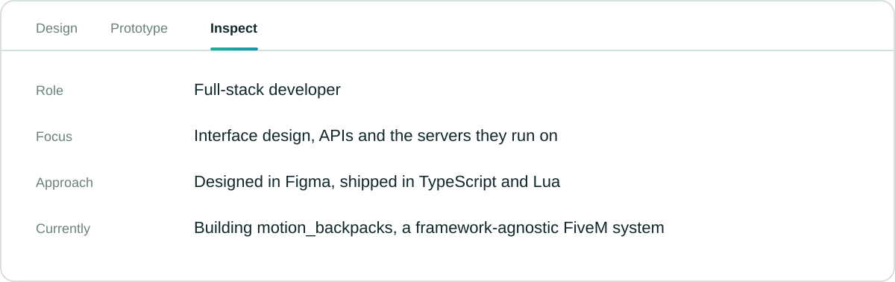
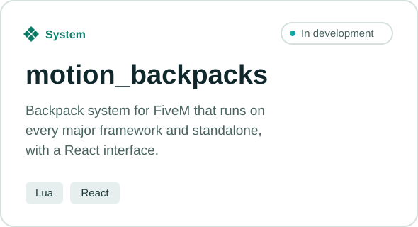
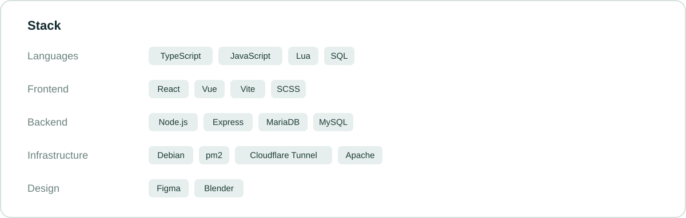

<picture><source media="(prefers-color-scheme: dark)" srcset="./assets/banner-dark.svg"></picture>

<picture><source media="(prefers-color-scheme: dark)" srcset="./assets/showcase-dark.svg"></picture>

<picture><source media="(prefers-color-scheme: dark)" srcset="./assets/about-dark.svg"></picture>

<a href="https://github.com/vexcreation/motion_lib"><picture><source media="(prefers-color-scheme: dark)" srcset="./assets/card-motion-lib-dark.svg"></picture></a>
<a href="https://github.com/vexcreation/motion_backpacks"><picture><source media="(prefers-color-scheme: dark)" srcset="./assets/card-motion-backpacks-dark.svg"></picture></a>

<picture><source media="(prefers-color-scheme: dark)" srcset="./assets/stack-dark.svg"></picture>

<a href="mailto:EMAIL_EINTRAGEN">EMAIL_EINTRAGEN</a>

